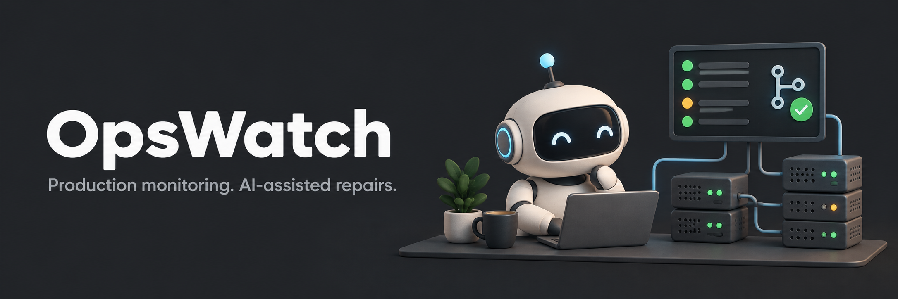

# OpsWatch



[](https://github.com/Nikola-Limpet/OpsWatch/actions/workflows/ci.yml)

A personal workspace for watching production applications and supervising AI-assisted repairs.

I built OpsWatch to keep track of the applications I maintain, collect useful evidence when something breaks, and let an agent investigate without giving it an open-ended mandate to change production. It brings service health, incidents, database timings, Telegram alerts, and repair attempts into one place.

This is my personal side project. The source is public so others can explore and adapt it, but the dashboard, credentials, monitored applications, and incident data are private. It is built around my workflow and is still evolving.

## What it does

- Checks HTTP endpoints, Railway and Vercel deployments/logs, Sentry issues, PostgreSQL databases, and configured server services.
- Records redacted evidence in SQLite and distinguishes application problems from collection failures and stale readings.
- Groups matching collection errors by provider account while keeping each affected incident accessible.
- Sends Telegram alerts with production context and links to the evidence.
- Uses Hermes or Codex to help investigate incidents. Deterministic monitoring keeps working without an LLM.
- Runs code repair attempts in isolated Git worktrees, validates changes, and prepares draft pull requests for review.
- Shows active attempts, blocked repairs, and draft PR outcomes in a dedicated Agent work view.
- Provides a local dashboard and an optional private Vercel dashboard through an outbound bridge.

Repairs do **not** merge, deploy, or run production migrations. Automatic diagnosis, automatic repairs, and firewall blocking are separate settings and are disabled in the example configuration.

## How it fits together

| Component | Responsibility |
| --- | --- |
| Local monitor | Collect checks, maintain incidents, and deliver alerts |
| SQLite store | Keep recorded checks, redacted evidence, delivery state, and repair jobs |
| Hermes / Codex | Diagnose evidence and investigate code in a bounded workflow |
| Repair worker | Run repository checks and publish validated changes as draft PRs |
| Local dashboard | Inspect evidence and use explicit monitoring/repair controls |
| Cloud bridge | Publish redacted snapshots and process supported dashboard commands |
| Vercel dashboard | Display the relay snapshot and queue commands back to the local worker |

The cloud dashboard does not collect production signals or execute repairs. Provider credentials and operational database connections stay with the local processes.

## Run locally

Requirements:

- Python 3.12+ and [uv](https://docs.astral.sh/uv/).
- Node.js 22+ for the JavaScript behavior tests.
- The provider CLIs needed for the integrations you enable. GitHub CLI and Git are needed for draft PR repairs; Hermes or Codex is needed for agent features.

```sh
git clone https://github.com/Nikola-Limpet/OpsWatch.git
cd OpsWatch
uv sync --frozen --group dev
cp config.example.yaml config.local.yaml
cp .env.example .env
```

Edit `config.local.yaml` to select the services you want to monitor. All example targets start disabled. Add credentials only to your local environment or `.env`, then check the setup:

```sh
uv run opswatch doctor
uv run opswatch check
```

`check` collects once and records incidents without sending Telegram messages or changing firewall rules. Start continuous monitoring and the dashboard in separate terminals:

```sh
uv run opswatch run
uv run opswatch dashboard
```

Open [http://127.0.0.1:8767](http://127.0.0.1:8767). The dashboard reads recorded data; opening it does not start checks or repairs. A different port can be selected with `dashboard --port 8768`.

For Linux autostart:

```sh
uv run opswatch install-service
systemctl --user daemon-reload
systemctl --user enable --now opswatch
```

## Configure integrations

Start with [config.example.yaml](config.example.yaml) and [.env.example](.env.example). Configuration is validated before use.

- **HTTP:** choose an endpoint, expected response statuses, and an optional body assertion.
- **Railway / Vercel / Sentry:** sign in to the appropriate CLI, discover inventory, and explicitly enable the targets you intend to monitor. Use named accounts and explicit Vercel team scopes when needed.
- **PostgreSQL / Neon:** use an environment-referenced monitoring DSN. SQL checks use read-only transactions and a statement timeout.
- **Servers:** configure an SSH alias and the systemd units or Docker containers to inspect.
- **Telegram:** set the bot token, destination chat, and allowed sender IDs locally. Choose standalone polling or the existing Hermes gateway.

```sh
uv run opswatch discover --providers railway vercel sentry neon
```

Discovery uses your signed-in accounts. Review the resulting local inventory and enabled targets before starting continuous monitoring.

## Agent-assisted repairs

Map a target to a verified repository and configure the setup/check commands that establish a valid change. Enable the repair worker separately:

```sh
uv run opswatch install-repair-service
systemctl --user daemon-reload
systemctl --user enable --now opswatch-repairs
```

Start a manual attempt from incident details, Telegram, or the CLI:

```sh
uv run opswatch fix OW-0001 --repo your-repository-id
uv run opswatch repairs
```

The worker creates an isolated worktree, asks the coding agent to investigate, independently runs the configured checks, and opens a draft PR when validation succeeds. Blocked attempts keep their evidence and worktree for inspection. Repair limits, cooldowns, and timeouts are configurable.

The agent does not receive the monitor's cloud tokens, Telegram credentials, or database DSNs in its environment. Repository setup and tests still execute on the machine running the worker, so configure trusted repositories and commands.

## Telegram commands

When the Hermes integration is configured:

| Command | Purpose |
| --- | --- |
| `/opsstatus` | Current application and monitor status |
| `/incidents` | List incidents |
| `/incident OW-0001` | Inspect recorded evidence |
| `/diagnose OW-0001` | Request a diagnosis |
| `/fix OW-0001` | Start a mapped repair attempt |
| `/repairs` | List repair jobs |
| `/repair RF-0001` | Inspect a repair attempt |
| `/cancelfix RF-0001` | Request cancellation before publication |
| `/queries` | Inspect measured query evidence |
| `/opshelp` | Available commands |

The plugin is in [scripts/hermes-plugin](scripts/hermes-plugin). Telegram buttons and dashboard controls use the same underlying incident and repair records.

## Optional private cloud dashboard

The repository includes a Vercel entrypoint at [api/index.py](api/index.py). A dedicated PostgreSQL relay stores redacted dashboard snapshots and supported commands. The local bridge makes outbound requests, so the monitor does not need an inbound public tunnel.

See [the deployment guide](docs/deployment.md) for environment variables, relay initialization, Git deployment, and bridge setup. Keep authentication enabled on every dashboard deployment. Publishing this repository does not make a monitoring workspace public.

## Development

```sh
uv sync --frozen --group dev
uv run pytest -q
uv run ruff check src scripts tests api
uv run ruff format --check src scripts tests api
node --check src/opswatch/dashboard_assets/app.js
node --test tests/dashboard-workspace.test.cjs
```

Tests use temporary data and isolated fixtures. PostgreSQL relay integration tests are skipped unless `OPSWATCH_TEST_DATABASE_URL` points to a dedicated test database. Do not use a production database for tests.

| Path | Contents |
| --- | --- |
| `src/opswatch/` | Monitoring, incidents, notifications, agents, and repairs |
| `src/opswatch/dashboard_assets/` | Dependency-free dashboard UI and bundled fonts |
| `api/` | Vercel dashboard entrypoint |
| `scripts/` | Cloud bundle builder, event sender, firewall helper, and Hermes integration |
| `tests/` | Monitoring, repair, cloud, privacy, and UI behavior coverage |

The bundled Geist fonts retain their [original license](src/opswatch/dashboard_assets/FONT-LICENSE.txt).

## Practical limits

Monitoring stops when the machine running it sleeps, disconnects, or shuts down. Use an always-on host and an external missing-heartbeat alert if continuous coverage matters. Provider polling and bounded log windows cannot guarantee capture of every event on busy applications.

A quiet error stream means matching events stopped; it does not prove a code defect was fixed. A draft PR means a change is ready for review; it does not prove production recovery. Historical evidence that was never retained cannot be reconstructed by the dashboard.

## Project direction

I am using this project to improve my own development and operations workflow. The next priorities are better correlation between incidents and deployments, production verification after reviewed fixes, and a useful backlog of recurring reliability problems. Issues and suggestions are welcome, but there is no support commitment or fixed roadmap.
